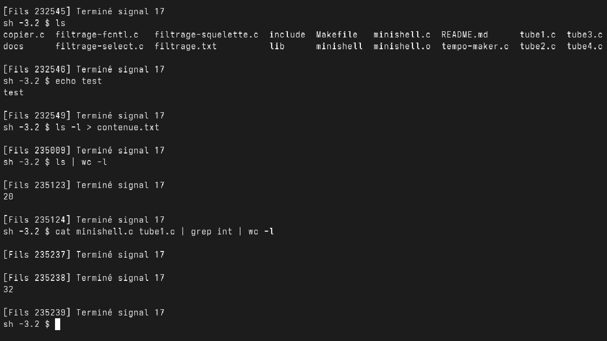

# ENSEEIHT - Operating Systems Minishell Project

This repository contains various programs developed in **C** as part of the
1st-year Operating Systems (*Systèmes d'Exploitation*) module at **ENSEEIHT**.

It explores fundamental low-level system programming concepts under UNIX/Linux
environments, including file descriptor manipulation, process creation,
inter-process communication (IPC via pipes), advanced signal handling, and
memory mapping (`mmap`).



## Repository Structure

The project includes several C source files and utilities illustrating core OS
concepts:

1. **Low-Level I/O & File Management**: Robust block-based file copying using
   `read` and `write` with proper error handling.
2. **Pipes and Process Creation (`fork`)**: 
   - Unidirectional data transmission between parent and child processes.
   - Synchronized read/write loops and non-blocking I/O.
3. **Signal Handling (`sigaction`, `signal`)**: Capturing signals (`SIGINT`,
   `SIGTSTP`, `SIGCHLD`) and manipulating signal masks.
4. **Memory Mapping (`mmap`)**: Sharing and privatizing memory regions between
   processes using temporary files.
5. **Mini-Shell**: Implementation of a custom shell supporting external command
   execution, input/output redirections (`<`, `>`), pipes (`|`), background
   execution (`&`), and built-in commands (`cd`, `exit`).

## Compilation & Execution

Most source files can be compiled individually using `gcc`.

To compile the minishell only, use Makefile :

```bash
make
```

```bash
./minishell
```
